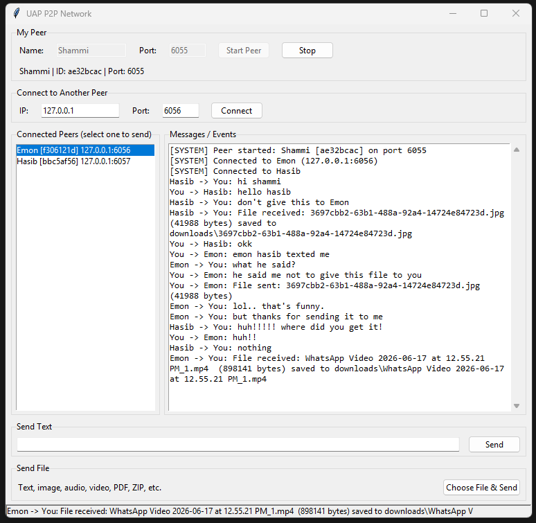
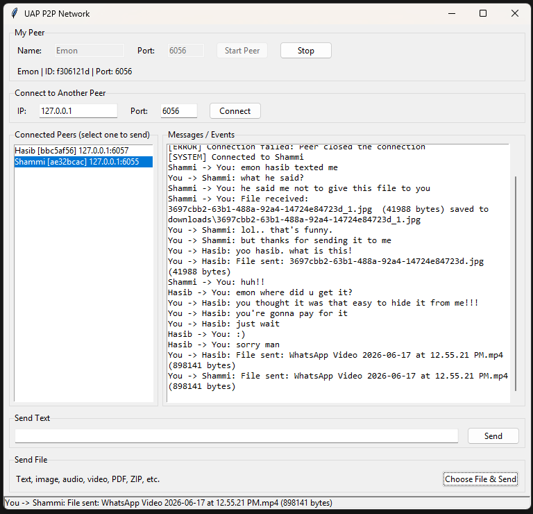
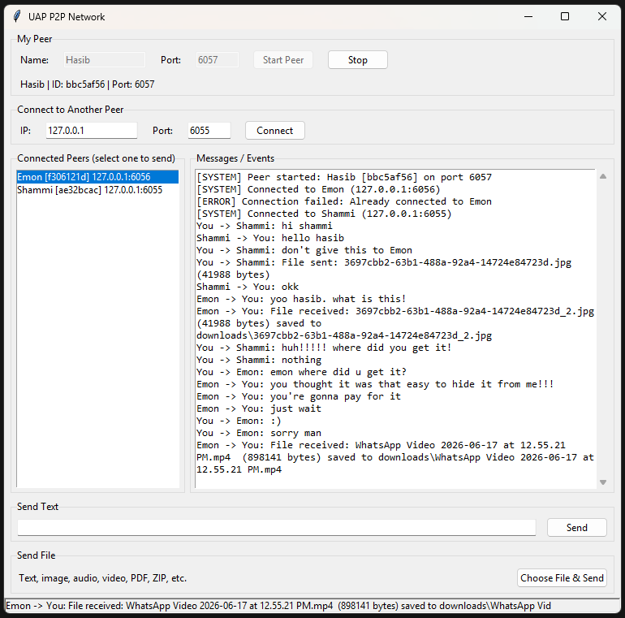

# P2P Network: Text and File Sharing

**Course:** CSE 433, Blockchain & Distributed Security Lab
**University:** University of Asia Pacific (UAP), Department of CSE
**Student:** MD Rawnak Shalahen Fahim
**ID:** 22201063
**Section:** C1

## Project description

This is a small peer-to-peer application written in Python. Every running copy of the program is one peer. A peer is both a TCP server (it accepts connections from others) and a TCP client (it connects to others), so there is no central server. Peers send text messages and files directly to each other.

Any file can be sent: text, images, audio, video, PDF, ZIP and so on. The program treats every file as plain binary data, so there is only one transfer path for all file types.

## Requirements

- Python 3.9 or later
- Tkinter (it comes with the standard Python installer for Windows and macOS)
- No third-party packages. `requirements.txt` only says so.

## Project structure

```
22201063_C1_P2P_Assignment/
|-- main.py            Tkinter user interface
|-- p2p_node.py        Sockets, threads, handshake, text and file transfer
|-- protocol.py        Message framing and message builders
|-- requirements.txt
|-- README.md
|-- downloads/         Received files are saved here
`-- screenshots/       Screenshots used in this README
```

| File | What it does |
|---|---|
| `main.py` | Draws the window, reads the user's input and calls the node. |
| `p2p_node.py` | Opens the listening socket, connects to other peers, keeps one thread per connection, sends and receives text and files. |
| `protocol.py` | Builds the JSON messages and handles the `[4-byte length][JSON]` framing. |

## Setup and run

1. Unzip the project and open the folder in a terminal or in VS Code.
2. Check your Python version: `python --version` (3.9 or higher).
3. Start a peer:

```
python main.py
```

On Windows, use `py main.py` if `python` is not recognized.

To run several peers on one computer, open one terminal per peer and run `python main.py` in each one. Each peer needs its own port.

## How to connect two peers

Example on one computer:

1. **Window 1:** Name `Shammi`, Port `6055`, click **Start Peer**.
2. **Window 2:** Name `Emon`, Port `6056`, click **Start Peer**.
3. In Emon's window, set IP `127.0.0.1` and Port `6055`, then click **Connect**.
4. Both windows now show each other under **Connected Peers**.

To add a third peer (`Hasib`, port `6057`), start it the same way and connect it to `127.0.0.1` port `6055`, then connect it again to port `6056`. After that, all three peers are connected to one another.

### Connecting over a LAN

1. All computers must be on the same Wi-Fi or LAN.
2. On the computer you want to reach, find its IPv4 address. On Windows run `ipconfig`. On Linux or macOS run `ip a` or `ifconfig`.
3. Type that address (for example `192.168.1.10`) and its port into the **Connect** box.
4. If the connection fails, allow Python through the Windows firewall.

## How to send a text message

1. Click a peer in the **Connected Peers** list.
2. Type the message in **Send Text**.
3. Press **Send** or hit Enter.

The message shows up in the log of both peers.

## How to transfer a file

1. Click a peer in the **Connected Peers** list.
2. Click **Choose File & Send** and pick any file.
3. The receiver saves it in its `downloads/` folder.

If a file with the same name already exists, the new one is saved as `name_1.ext`, `name_2.ext` and so on. Existing files are never overwritten.

## How it works

1. **Startup.** The peer creates a TCP socket, calls `bind` and `listen`, and starts a thread that waits in `accept`.
2. **Connecting.** The client side creates a socket and calls `connect` with the other peer's IP and port.
3. **Handshake.** The connecting peer sends a `hello` message with its ID, name and listening port. The other peer replies with `hello_ack`. After this both sides know who they are talking to.
4. **Threads.** Every connection gets its own thread that reads incoming messages, so a peer can talk to many peers at once.
5. **Framing.** TCP is a byte stream and does not keep message boundaries. Every JSON message is sent as `[4-byte length][JSON payload]`. The receiver reads 4 bytes, learns the length, and then reads exactly that many bytes.
6. **Text.** A `text` message carries the sender's ID, name and the message.
7. **Files.** A `file` message carries the filename and the file size. Right after it, the sender streams exactly that many raw bytes in 64 KB chunks, so large files never have to fit in memory. The receiver uses the size from the metadata to know when the file is complete.

Message types: `hello`, `hello_ack`, `text`, `file`.

## Error handling

The program shows a message in the log or a dialog instead of crashing for:

- invalid IP address or port
- connection refused or timed out
- connecting to a peer you are already connected to
- a peer disconnecting, including in the middle of a file transfer (a half-received file is deleted)
- a file that does not exist
- sending without selecting a peer
- a port that is already in use

## Testing

Tested on one computer with three peers running at the same time:

| Peer | Port |
|---|---|
| Shammi | 6055 |
| Emon | 6056 |
| Hasib | 6057 |

What was tested:

- Connecting the peers to each other and viewing the connected peer list
- Text messages in both directions between different pairs
- Image transfer between different pairs
- Audio and video transfer
- Duplicate connection attempts (rejected with an error message)

## Screenshots

### Peer 1: Shammi (port 6055)


### Peer 2: Emon (port 6056)


### Peer 3: Hasib (port 6057)

